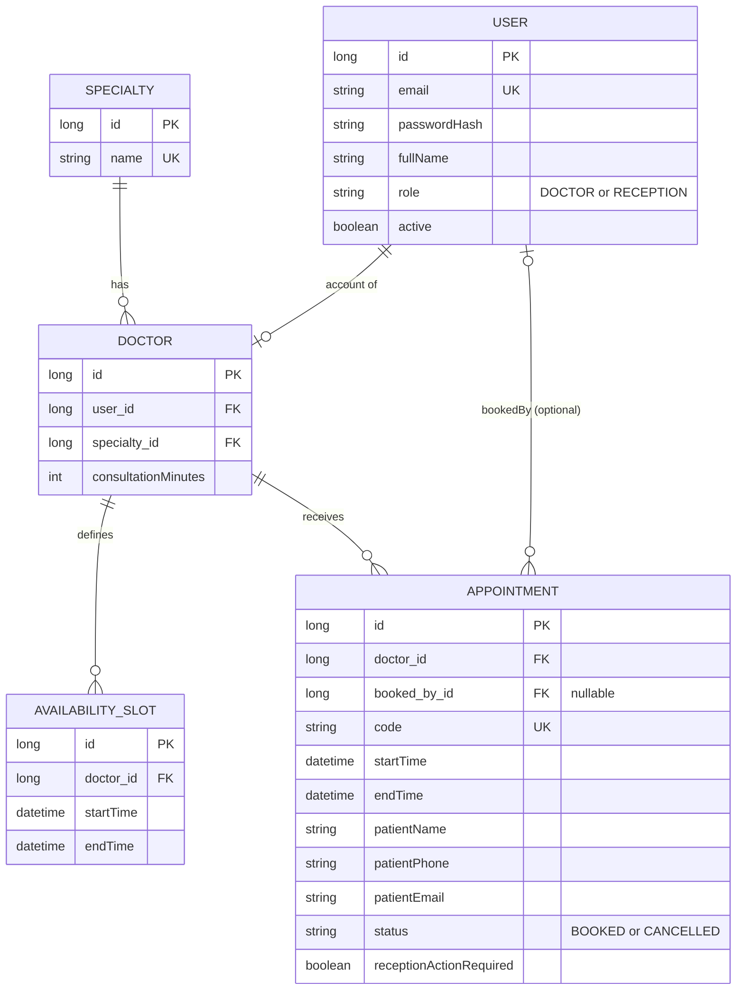

# Clinic Appointment Booking: Design Note

## 1. Problem

A small clinic currently manages appointments by phone and writes patient names in a paper diary. This manual process makes it difficult to keep track of the doctors' real availability and existing appointments. Double bookings can occur when two patients are given the same time slot, and appointments can be forgotten or recorded incorrectly. When a doctor's availability changes, it is also difficult to identify which existing appointments are affected and which patients need to be contacted.

## 2. Users and roles

- **Patient**: anonymous, no account. Books through a form and cancels with a cancellation code.
- **Doctor**: has an account created by reception. Manages their own availability and views their own schedule only.
- **Reception**: views all doctors' availability and schedules, books on behalf of a patient, manages doctor and receptionist accounts (create, edit, deactivate), and handles appointments affected by availability changes.

The first reception account comes from seed data (development only).

## 3. User stories

1. As a patient, I want to view the list of doctors with their specialty and consultation length.
2. As a patient, I want to view a doctor's open slots for a given date.
3. As a patient, I want to book an appointment without an account and receive a cancellation code.
4. As a patient, I want to cancel my appointment with my code up to one hour before it starts.
5. As a doctor, I want to enter and edit my availability without going through reception.
6. As a doctor, I want to view my daily schedule with patient details.
7. As reception, I want to book on behalf of a patient from a centralized view of availability.
8. As reception, I want to create, edit and deactivate doctor and receptionist accounts.
9. As reception, I want to see the list of appointments affected by an availability change or a doctor deactivation, so I can contact the patients and reschedule or cancel.

## 4. Data model

- No Reception entity: a receptionist is a `User` with `role = RECEPTION`.
- No Patient entity: patients have no account and are not reused between bookings, so their details live in `Appointment`. `PATIENT` is never a value of `User.role`.
- `User` logs in with `email` (unique) instead of a separate username: one fewer field, and it is already unique and meaningful for staff.
- `bookedBy` is null when the patient books through the form, and points to a receptionist when reception books on their behalf.
- `receptionActionRequired` marks a `BOOKED` appointment that is not covered by the doctor's availability (or belongs to a deactivated doctor) and which reception must handle explicitly.

## 5. The hard part: time

Two appointments for the same doctor must never overlap. With half-open intervals `[start, end)`, the overlap condition is:

`existing.startTime < requested.endTime AND existing.endTime > requested.startTime`

An appointment ending at 09:30 and another starting at 09:30 do not overlap. One ending at 10:00 and another starting at 09:30 do.

**Which appointments block a slot:**
- `CANCELLED` appointments never block, whoever cancelled them (patient, doctor or reception).
- `BOOKED` appointments always block, **including those with `receptionActionRequired = true`**, until reception cancels or reschedules them. Otherwise, a slot still held by a patient could be booked again if the doctor restores the availability.

**When is a slot bookable?** Only if both conditions hold: it is inside one of the doctor's availability slots, **and** it overlaps no `BOOKED` appointment.

**Time model:** `LocalDateTime` in the `Africa/Tunis` zone, with no conversion. "Now" comes from an injected `Clock` so that tests can fix the time. The one-hour cancellation rule uses the same zone. The cancellation deadline is computed as `startTime - 1 hour` (exposed as `cancellableUntil`) and is not stored. The rule is enforced in the service, not only in the page.

**Availability slots** must have `start < end` and fit inside a single day (no slot crossing midnight).

## 6. Availability changes and affected appointments

Availability only decides whether **new** bookings are accepted. An existing appointment is a separate commitment.

- A doctor or reception may remove or modify an availability slot, or deactivate a doctor.
- Existing `BOOKED` appointments are never deleted or cancelled automatically.
- **Recalculation rule.** After every availability change, the service recalculates `receptionActionRequired` for the doctor's future `BOOKED` appointments, in the same transaction as the change: covered by an availability slot gives `false`, not covered gives `true`. A deactivated doctor has no availability, so all their future `BOOKED` appointments are flagged.
- **Restoring availability.** If the doctor restores the availability before reception has handled the appointment, the flag returns to `false` automatically and the appointment stays `BOOKED`. It disappears from reception's list of appointments to handle.
- **Handling an affected appointment.** Reception contacts the patient, then either cancels the appointment or reschedules it.
- **Rescheduling** keeps the original appointment as history (`status = CANCELLED`) and creates a new appointment for the new time.
- When reception cancels an affected appointment, the final state is `status = CANCELLED` and `receptionActionRequired = false`.
- A deactivated doctor no longer appears in the public doctor list or open slots.
- Reception's view is a list of `BOOKED` appointments with `receptionActionRequired = true`. No Notification or AvailabilityChange entity is needed: this is a service-level business rule.
- **Trade-off.** If reception has already called the patient when the availability comes back, the patient was contacted unnecessarily. This is acceptable for a small clinic and avoids blocking the doctor.

## 7. The two risks I worry about most

**Risk 1: simultaneous bookings / overlap.**
Two patients may book the same slot at the same moment, and both overlap checks can pass before either insert. A uniqueness constraint on `(doctor, startTime)` is not enough because it misses partial overlaps. The booking transaction takes a pessimistic lock on the doctor's row, so bookings for the same doctor are serialized. Concurrent booking is tested explicitly with two threads.

**Risk 2: PostgreSQL deployment on a clean server.**
The application may work in development (H2) but fail on a clean server because of datasource configuration, a missing PostgreSQL driver, environment variables or schema differences. The production deployment is tested separately on a clean WildFly with PostgreSQL and documented so another person can reproduce it.