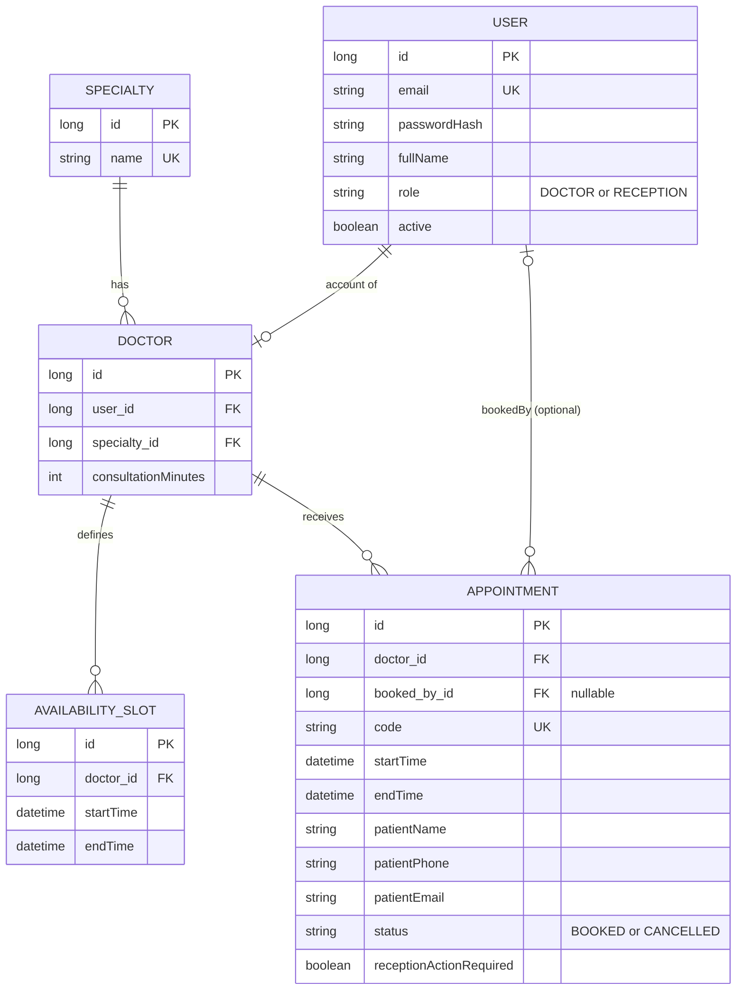

# Clinic Appointment Booking: Design Note

## 1. Problem

A small clinic currently manages appointments by phone and writes patient names in a paper diary. This manual process makes it difficult to keep track of the doctor's real availability and existing appointments. Double bookings can occur when two patients are given the same time slot, and appointments can be forgotten or recorded incorrectly. When a doctor's availability changes, it can also be difficult to identify which existing appointments are affected and which patients need to be contacted.

## 2. Users and roles

- **Patient**: anonymous, no account. Books through a form and cancels with a cancellation code.
- **Doctor**: has an account created by reception. Manages their own availability and views their own schedule.
- **Reception**: views all doctors' availability, books on behalf of a patient, manages doctor and receptionist accounts (create, edit, deactivate), and handles appointments affected by doctor availability changes.

The first reception account comes from seed data.

## 3. User stories

1. As a patient, I want to view the list of doctors with their specialty and consultation length.
2. As a patient, I want to view a doctor's open slots for a given date.
3. As a patient, I want to book an appointment without an account and receive a cancellation code.
4. As a patient, I want to cancel my appointment with my code up to one hour before it starts.
5. As a doctor, I want to enter and edit my availability without going through reception.
6. As a doctor, I want to view my daily schedule with patient details.
7. As reception, I want to book on behalf of a patient from a centralized view of availability.
8. As reception, I want to create, edit and deactivate doctor and receptionist accounts.

## 4. Data model

- No separate Reception entity: a receptionist is a `User` with `role = RECEPTION`.
- No Patient entity: patients have no account, so their details live in `Appointment`. `PATIENT` is never a value of `User.role`.
- `bookedBy` is a nullable foreign key to `User`. It is null when the patient books through the form, and points to a receptionist when reception books on their behalf.
- `receptionActionRequired` indicates that a BOOKED appointment has been affected by a change in the doctor's availability or doctor deactivation and requires explicit handling by reception.

## 5. The hard part: time

Two appointments for the same doctor must never overlap. With half-open intervals, the overlap condition is:

`existing.startTime < requested.endTime AND existing.endTime > requested.startTime`

An appointment ending at 09:30 and another starting at 09:30 do not overlap.

**Time model:** `LocalDateTime` in the `Africa/Tunis` zone, with no conversion. The one-hour cancellation rule uses the same zone. The cancellation deadline is computed as `startTime - 1 hour` and is not stored.

## 6. The two risks I worry about most

**Risk 1: simultaneous bookings / overlap.**

Two patients may book the same slot at the same moment, and both checks can pass. A uniqueness constraint on `(doctor, startTime)` is not enough because it misses partial overlaps. The booking transaction uses a pessimistic lock on the doctor's row, and concurrent booking is tested explicitly.

**Risk 2: PostgreSQL deployment on a clean server.**

The application may work in development but fail on a clean server because of database configuration, datasource configuration, missing PostgreSQL driver, environment variables or schema differences. The production deployment therefore needs to be tested separately on a clean WildFly server with PostgreSQL and documented so that another person can reproduce it.