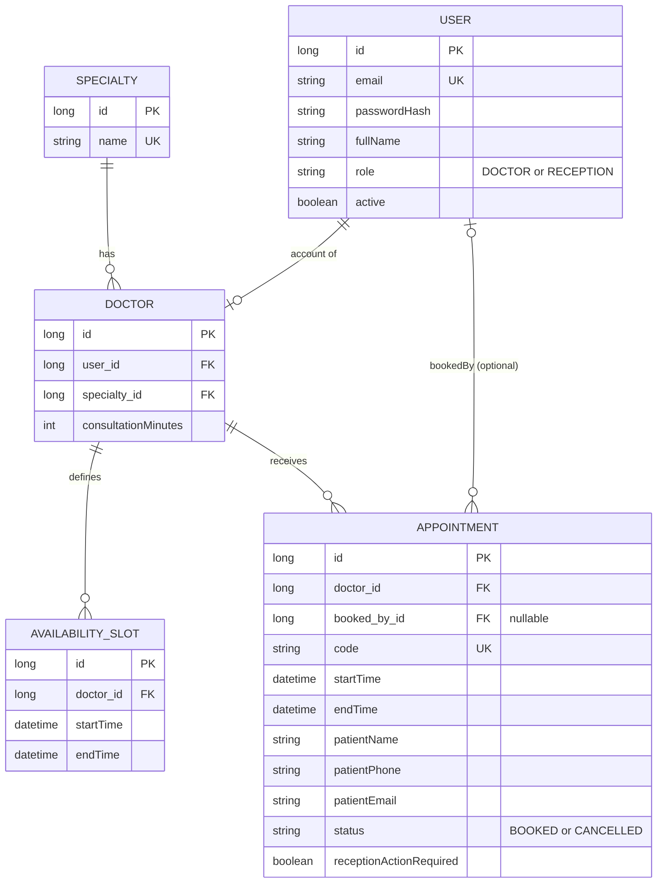

# Entity-Relationship Diagram

## Diagram

## Entities

| Entity | Purpose |
|---|---|
| User | Account of a doctor or a receptionist (login by email, role, active flag) |
| Specialty | Medical specialty (for example cardiology) |
| Doctor | Doctor profile: account, specialty and consultation length |
| AvailabilitySlot | A time range during which a doctor accepts new bookings |
| Appointment | A booking, with the patient's details, cancellation code, and the reception-handling flag |

## Relationships

| Relationship | Type | Foreign key held by | JPA mapping |
|---|---|---|---|
| Specialty to Doctor | One-to-many | Doctor (`specialty_id`) | `@ManyToOne` on Doctor |
| User to Doctor | One-to-one, optional from User side | Doctor (`user_id`) | `@OneToOne` on Doctor |
| Doctor to AvailabilitySlot | One-to-many | AvailabilitySlot (`doctor_id`) | `@OneToMany(mappedBy = "doctor")` on Doctor, `@ManyToOne` on AvailabilitySlot |
| Doctor to Appointment | One-to-many | Appointment (`doctor_id`) | `@OneToMany(mappedBy = "doctor")` on Doctor, `@ManyToOne` on Appointment (owning side) |
| User to Appointment (`bookedBy`) | One-to-many, optional | Appointment (`booked_by_id`, nullable) | `@ManyToOne(optional = true)` on Appointment |

## Design decisions

- **No Reception entity.** A receptionist is a `User` with `role = RECEPTION`.
- **No Patient entity.** Patients are anonymous and have no account. Their details are stored in `Appointment`.
- **Login by email.** `User.email` is unique and replaces a separate username.
- **`bookedBy`** is null when the patient books online and points to a receptionist when reception books on behalf of a patient.
- **Appointments are never deleted.** Cancelling sets `status = CANCELLED`, which keeps the history.
- **What blocks a slot.** `CANCELLED` appointments never block, whoever cancelled them. `BOOKED` appointments always block, including those with `receptionActionRequired = true`.
- **When a slot is bookable.** It must be inside an availability slot and overlap no `BOOKED` appointment.
- **Cancellation deadline.** Patients can cancel up to one hour before the start. The deadline is computed (`startTime - 1 hour`, exposed as `cancellableUntil`) and not stored. It is enforced in the service.
- **Time model.** All date-times are `LocalDateTime` in the `Africa/Tunis` zone, with no conversion. "Now" comes from an injected `Clock`.
- **Availability changes do not delete or cancel appointments.** The service recalculates `receptionActionRequired` for the doctor's future `BOOKED` appointments after every availability change, in the same transaction: covered gives `false`, not covered gives `true`.
- **Restored availability.** If availability is restored before reception handles the appointment, the flag returns to `false` automatically and the appointment stays `BOOKED`.
- **Doctor deactivation** (`User.active = false`) hides the doctor from public lists and slots. Future bookings stay `BOOKED` and are flagged for reception.
- **Reception handles affected appointments.** Reception sees the list of flagged appointments, contacts the patient and either reschedules or cancels.
- **Rescheduling keeps history.** The original appointment becomes `CANCELLED` and a new appointment is created for the new time.
- **No Notification entity.** The reception workflow is represented by `receptionActionRequired` and the list built from it.

## Constraints

- `User.email`, `Specialty.name` and `Appointment.code` are unique.
- `startTime < endTime` on `AvailabilitySlot` and `Appointment`.
- An `AvailabilitySlot` fits inside a single day.
- `Doctor.consultationMinutes > 0`.
- Two appointments of the same doctor overlap when:
  `existing.startTime < requested.endTime AND existing.endTime > requested.startTime`
  (only non-`CANCELLED` appointments are compared).
- Enforced in the service: `Appointment.bookedBy` is null or a `User` with role `RECEPTION`; `Doctor.user` is a `User` with role `DOCTOR`.
- A change to availability never changes `status`; it only recalculates `receptionActionRequired`.
- When reception cancels an affected appointment: `status = CANCELLED` and `receptionActionRequired = false`.