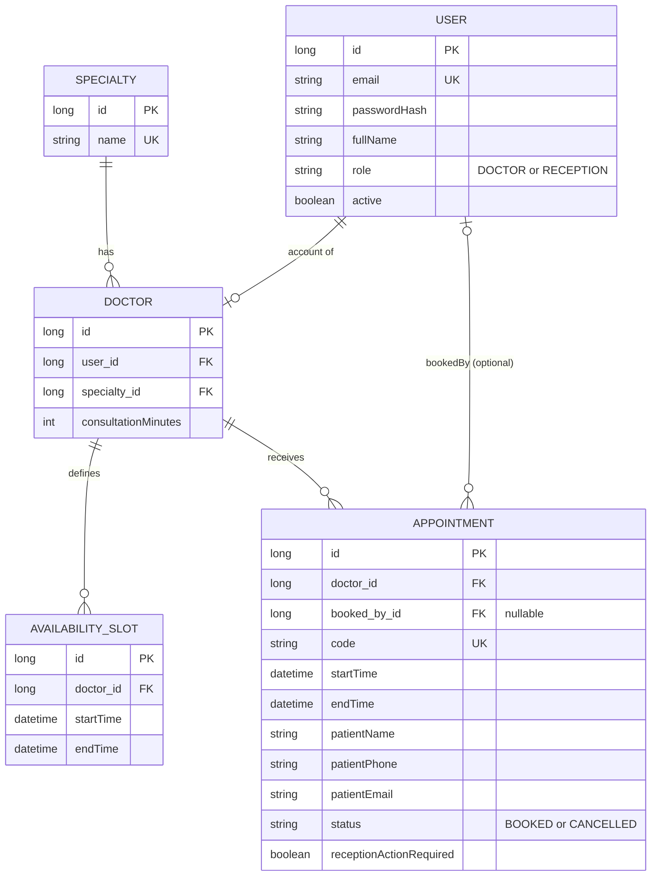

# Entity-Relationship Diagram

## Diagram

## Entities

| Entity | Purpose |
|---|---|
| User | Account of a doctor or a receptionist (login, role, active flag) |
| Specialty | Medical specialty (for example cardiology) |
| Doctor | Doctor profile: specialty and consultation length |
| AvailabilitySlot | A time range during which a doctor is available |
| Appointment | A booking, with the patient's details, cancellation code, and reception handling status when required |

## Relationships

| Relationship | Type | Foreign key held by |
|---|---|---|
| Specialty to Doctor | One-to-many | Doctor (`specialty_id`) |
| User → Doctor | One-to-one, optional from User side | Doctor (`user_id`) |
| Doctor to AvailabilitySlot | One-to-many | AvailabilitySlot (`doctor_id`) |
| Doctor to Appointment | One-to-many | Appointment (`doctor_id`) |
| User to Appointment (`bookedBy`) | One-to-many, optional | Appointment (`booked_by_id`, nullable) |

## Design decisions

- **No Reception entity.** A receptionist is a `User` with `role = RECEPTION`.
- **No Patient entity.** Patients are anonymous and have no account. Their details are stored directly in `Appointment`.
- **`bookedBy`** is null when the patient books online and points to a receptionist when reception books on behalf of a patient.
- **Appointments are never deleted.** Cancelling sets `status = CANCELLED`, which keeps the history. Cancelled appointments do not block a slot.
- **Cancellation deadline.** Patients can cancel up to one hour before the appointment. The deadline is computed as `startTime - 1 hour` and is not stored.
- **Time model.** All date-times are `LocalDateTime` in the `Africa/Tunis` zone, with no conversion.
- **Availability changes do not automatically delete appointments.** Affected `BOOKED` appointments remain in the database.
- **`receptionActionRequired`** identifies an existing BOOKED appointment that requires reception intervention because it was affected by an availability change or doctor deactivation.
- **Reception handles affected appointments.** Reception contacts the patient and either reschedules or cancels the affected appointment.
- **Rescheduling keeps the historical appointment.** The original appointment remains as historical data and is treated as cancelled. A new appointment is created for the new date/time.
- **Doctor deactivation does not automatically delete future appointments.** Existing future bookings remain available for reception to handle.
- **No separate Notification entity.** The reception workflow is represented by `receptionActionRequired`.

## Constraints

- `User.email`, `Specialty.name` and `Appointment.code` are unique.
- `startTime < endTime` on `AvailabilitySlot` and `Appointment`.
- `Doctor.consultationMinutes > 0`.
- Two appointments of the same doctor overlap when:

  `existing.startTime < requested.endTime AND existing.endTime > requested.startTime`

- Role rules are enforced in the service: `Appointment.bookedBy` must be null or a `User` with role `RECEPTION`; `Doctor.user` must be a `User` with role `DOCTOR`.
- A change to availability does not automatically change the status of affected appointments.
- When reception cancels an affected appointment, the final state is `status = CANCELLED` and `receptionActionRequired = false`.